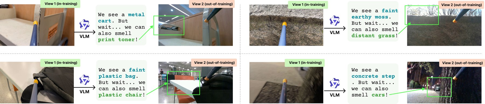
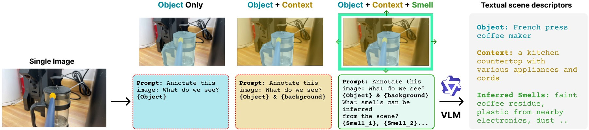
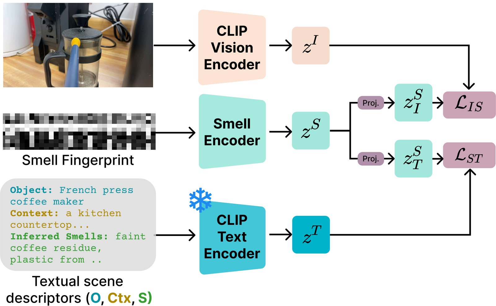
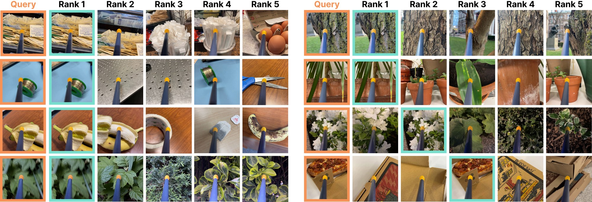

# SCENT: Language-Guided Olfactory Representation Learning

Official code and weights for **"What Images Cannot Say: Language-Guided Olfactory Representation Learning"**
(ECCV 2026). [arXiv](https://arxiv.org/abs/2607.06402)

Eleftherios Tsonis, Xi Wang, Vicky Kalogeiton - LIX, École Polytechnique, IP Paris, CNRS



**Abstract.** Images tell us what a scene looks like, but rarely what it would feel like to be there. While recent
datasets pair visual scenes with electronic-nose measurements, aligning smell signals with images remains
challenging because many olfactory cues arise from contextual environmental factors that are not directly visible
in pixels. We introduce SCENT, a multimodal framework that uses language as a semantic bridge between vision and
olfaction. Our approach leverages Vision-Language Models (VLMs) to generate scene descriptors capturing objects,
environmental context, and plausible ambient smell cues suggested by the visual scene. These descriptors provide
semantic guidance for learning olfactory representations. We train a smell encoder that maps electronic-nose
signals into a shared embedding space aligned with both visual and textual representations, and introduce a
language-guided latent decomposition that separates object-specific odors from contextual environmental
contributions. Experiments on the New York Smells dataset demonstrate that SCENT significantly improves
cross-modal retrieval compared to vision-only baselines, achieving state-of-the-art performance on smell-to-image
and smell-to-text retrieval tasks. In addition, our framework produces interpretable olfactory representations that
enable the disentanglement of complex smell mixtures. Our results reveal the importance of contextual semantic
information for grounding olfactory perception in multimodal learning and pave the way for future research in
this area.

## Method



A pretrained VLM annotates every training image with an object, its context and the ambient smells the scene
suggests (O + Ctx + S). The three descriptors form one caption, `"{object} in {context} with smells of {s1}, {s2}, ..."`.



A transformer encodes the 28×32 e-nose fingerprint (baseline and sample stage) into z^S; two projection heads align
it with CLIP's image embedding (fine-tuned, L_IS) and with the CLIP text embedding of the caption
(frozen, L_ST) through InfoNCE. This repository contains the smell representation learning stage and
the retrieval evaluation.

## Setup

```bash
pip install -r requirements.txt            # PyTorch >= 2.1, torchvision, transformers >= 4.40
```

`pip` installs the PyTorch build for the newest CUDA toolkit. If your NVIDIA driver is older, install a matching build from [pytorch.org](https://pytorch.org/get-started/locally/) first and then run the command above.

## Data

SCENT trains on the public [New York Smells](https://smell.cs.columbia.edu/) dataset.

```bash
python scripts/download.py --root data/nys --out data/images
```

This fetches the dataset from its Hugging Face mirror into `data/nys` and prepares the images
under `data/images`; the e-nose recordings are read directly from the downloaded tree. If you already have the
official `smell-dataset.tar.gz`, extract it so that its `dataset/` folder is `data/nys` and run the same command:
the download is skipped.

Shipped with the repository:

- `data/annotations.jsonl` - one record per sample: VLM-generated `object`, `background` (scene context) and
  `smells` (plausible ambient smells), plus closed-set `item` / `environment` labels used only for
  probing. Generated with Qwen3-VL-30B-A3B-Instruct.
- `data/splits/{train,val}.json` - the training and validation splits used in the paper. The public release of the New York Smells splits postdates the paper, so we use our own split.

Sample ids are `<session>_<index>`, matching `<session>/rgb/<index>_rgb.png` in the public tree.

## Evaluate the released model

Download [`scent.pt`](https://github.com/eleftsonis/SCENT/releases/tag/v1.0), then:

```bash
python scripts/evaluate.py --checkpoint scent.pt
python scripts/probe.py --checkpoint scent.pt       # linear / MLP probes of z_S (appendix)
```

The released weights are an exponential moving average (EMA, decay 0.999) of the training weights, which gives a
stabler and slightly better model. Validation Recall@1/5/10/20:

| S2I | S2T | S2IT |
|---|---|---|
| 7.3 / 24.9 / 35.5 / 47.3 | 3.3 / 12.2 / 19.7 / 31.4 | 6.9 / 25.1 / 35.1 / 48.5 |

S2I: smell query, image gallery. S2T: smell query, caption gallery. S2IT: smell query, (image, caption) pair
gallery, scored with a blend of the two similarities (`α·cos(z_S→I, z_I) + (1−α)·cos(z_S→T, z_T)`); the
evaluation script reports every α for similarity- and latent-level fusion, and I2S / T2S.



S2IT retrieval: the ground-truth image of each smell query (orange) and the images of the top-5 retrieved
(image, caption) pairs, correct match in teal.

## Train

```bash
python scripts/train.py --config configs/scent.json --output_dir runs/scent
```

The run writes
`log.csv` (all metrics for raw and EMA weights at every evaluation), `best_ema.pt` / `best_raw.pt`
(selected by S2I R@5 + S2T R@5 + S2IT R@5 on the validation split) and `last_ema.pt`.
Set `"wandb_project"` in the config to log to Weights & Biases.

## Citation

```bibtex
@inproceedings{tsonis2026scent,
  title     = {What Images Cannot Say: Language-Guided Olfactory Representation Learning},
  author    = {Tsonis, Eleftherios and Wang, Xi and Kalogeiton, Vicky},
  booktitle = {ECCV},
  year      = {2026}
}
```

## License

Code: MIT (see `LICENSE`). The annotation and split files in `data/` are derived from the
[New York Smells](https://smell.cs.columbia.edu/) dataset and are shared under its CC BY 4.0 licence; the released weights are CC BY 4.0.
The vision encoder is fine-tuned from OpenAI's [CLIP](https://github.com/openai/CLIP) ViT-B/16 (MIT, Copyright (c) 2021 OpenAI).
